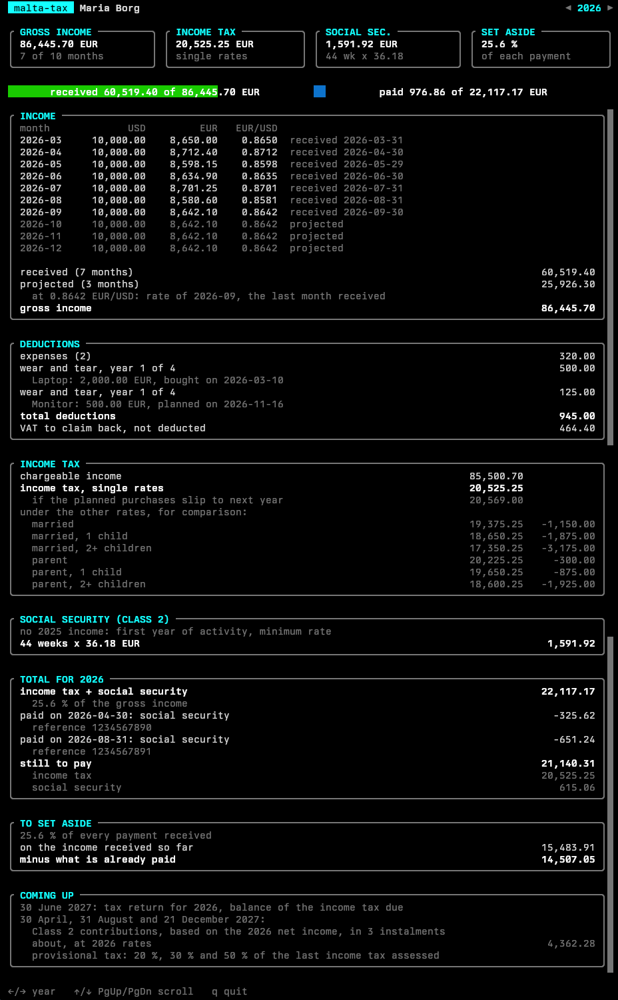

# malta-tax

Estimates the Maltese income tax and Class 2 social security contributions of
a self-occupied person for one year, from a JSON file, to know how much to set
aside. It is written for someone who invoices in USD and is paid in EUR.

    cargo run -- example.json          # the last year that has income
    cargo run -- example.json 2026     # a given year

`example.json` is a made-up set of accounts to start from.

It is an estimate, not a tax return, and not tax advice. The rules live in
`src/rules.rs`, one set per year, each with its source.

## Terminal interface

    cargo run -- --tui example.json

shows the same report as a dashboard: the key figures, how much of the year's
income is in and how much is paid, then every section in a scrollable panel.



| Key | |
|---|---|
| `←` `→` or `h` `l` | previous or next year |
| `↑` `↓` or `k` `j`, `PgUp` `PgDn`, `Home` `End` | scroll |
| `q` or `Esc` | quit |

The year arrows and the scrollbar also answer to the mouse.

It is built on [blit](https://github.com/nicoburniske/blit), which needs a
terminal that speaks the kitty keyboard protocol, such as Kitty or Ghostty.
blit is experimental and not on crates.io, so it is a git dependency pinned to
a commit, behind the default `tui` feature: `cargo build
--no-default-features` builds without it.

## Limits

- Only the rules of basis year 2026 are in.
- Class 2 contributions are those of a self-occupied person born on or after
  1 January 1962.
- Three rules come from secondary sources and were not checked against the
  legal text: a full year of wear and tear in the year an asset is bought,
  Class 2 contributions not being deductible from the chargeable income, and
  the 2026 ceiling of the Class 2 contributions.

## The JSON file

One file holds every year since the activity started: an asset is deducted
over several years, and each year's contributions are based on the net income
of the year before.

```json
{
  "taxpayer": {
    "name": "Maria Borg",
    "tax_status": "single",
    "activity_start": "2026-03-01",
    "vat_recoverable": true
  },
  "fx": { "usd_per_eur": 1.1355, "source": "ECB reference rate of 2026-09-30" },
  "income": [
    { "month": "2026-12", "usd": 10000, "eur": 8642.10, "received": "2026-12-30" },
    { "month": "2027-01", "usd": 10000, "eur": null, "note": "not paid yet" }
  ],
  "expenses": [
    { "date": "2026-05-04", "description": "Accountant", "eur": 300 }
  ],
  "assets": [
    { "date": "2026-09-15", "description": "Laptop", "category": "computer", "eur": 2360, "vat_eur": 360 }
  ],
  "payments": [
    { "date": "2026-08-31", "year": 2026, "kind": "social_security", "eur": 651.24, "reference": "1234567890" }
  ]
}
```

- `tax_status`: `single`, `married`, `married_one_child`,
  `married_two_or_more_children`, `parent`, `parent_one_child` or
  `parent_two_or_more_children`. The report shows the tax under the other
  rates too.
- `activity_start`: optional. Class 2 contributions are counted from the week
  of that day.
- `income`: one entry per month invoiced. `eur` is what was received; a month
  with `"eur": null` is projected from its `usd` at the rate of the last month
  received, or at `fx.usd_per_eur` when no month was received yet. `usd` and
  `received` are optional on a month that has its `eur`.
- `expenses`: deducted in full, in the year of their `date`.
- `assets`: deducted over several years from the year of their `date`
  (`computer` and `software` 4, `other_machinery` 5, `furniture` 10).
  `business_use_percent` defaults to 100. An asset with `"planned": true` is
  not bought yet: it is counted, and the report also shows the tax without it.
- `eur` of a purchase is the price paid, VAT included, and `vat_eur` the VAT in
  it. With `vat_recoverable` (Article 10 registration, defaults to `false`)
  that VAT is claimed back, so it is left out of the deductions.
- `payments`: `provisional_tax` and `social_security` paid, each for the
  `year` it settles, which can differ from the year of its `date`. `reference`
  is optional.

The Class 2 contributions of a year are based on the net income the file
gives for the year before. A year before which the file has no income is
taken as the first year of activity, at the minimum rate.

## License

Licensed under either of the Apache License, Version 2.0
([LICENSE-APACHE](LICENSE-APACHE)) or the MIT license
([LICENSE-MIT](LICENSE-MIT)), at your option.
